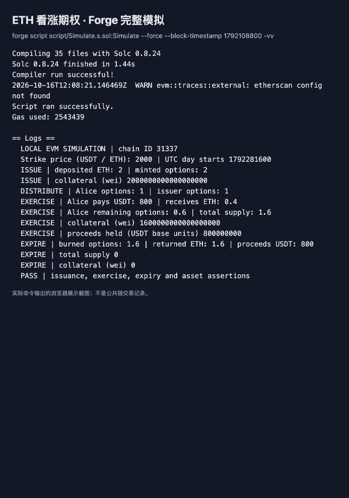
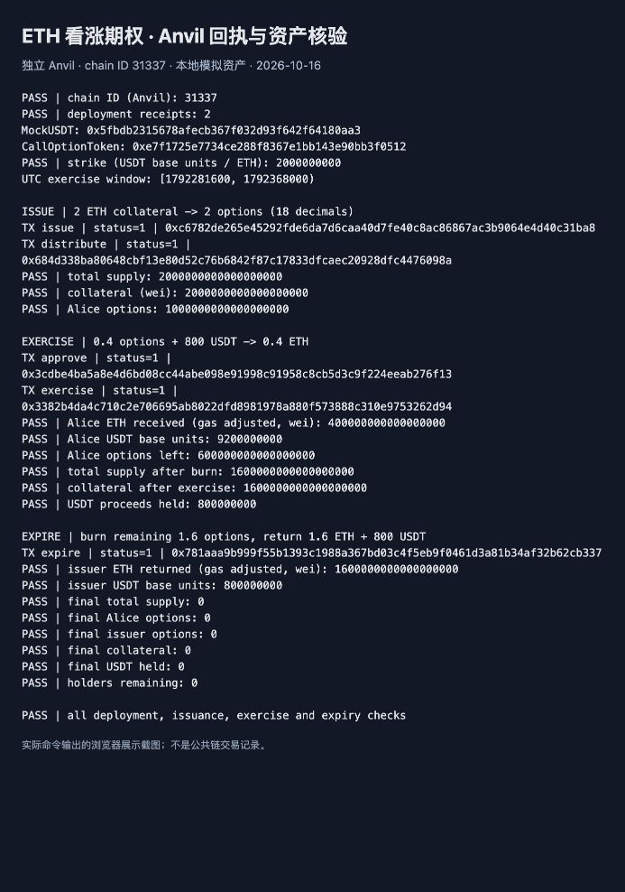

# 29 · ETH 看涨期权 Token

这份练习让项目方先锁住 ETH，再发行能在约定日期按固定价格买入 ETH 的 ERC20 期权。**1 枚期权对应 1 ETH**。用户持有的是兑换权，不是已经拿到的 ETH；要行权，还需要支付行权款。

例如项目方存入 2 ETH，得到 2 枚 `ETH-CALL`，约定每 ETH 的行权价为 2000 USDT。Alice 获得 1 枚期权，在到期日行权 0.4 枚：支付 800 USDT，收到 0.4 ETH，0.4 枚期权被销毁。她还剩 0.6 枚，合约还抵押着 1.6 ETH。过期后，项目方销毁全部剩余 1.6 枚期权，取回 1.6 ETH 和收到的 800 USDT。

## 题目与实现选择

题目来源为本次「设计一个看涨期权 Token」练习。转账、授权、余额和事件复用 OpenZeppelin 的 [ERC20 接口](https://eips.ethereum.org/EIPS/eip-20)，没有另写代币账本。

- **创建**：`constructor(paymentToken, strikePrice, exerciseStart)` 固定支付币、行权价和日期；部署者成为唯一发行方，之后不能修改条款或转移角色。行权价指每 1 ETH 要支付的代币最小单位，不查询市场现价或预言机。
- **日期**：`exerciseStart` 必须是未来的 **UTC 零点**，行权窗口为 `[exerciseStart, exerciseStart + 86400)`。UTC 当天对应北京时间当天 08:00 到次日 08:00；这不是按北京时间划分的自然日。
- **发行**：发行方在行权日之前调用 `issue()` 并转入 ETH。1 wei ETH 铸造 1 个期权最小单位；Token 精度为 18，不存在无抵押增发。
- **流转**：到期前可 `transfer`、`approve`、`transferFrom`。本题可选的期权/USDT 交易池未实现；演示直接转给 Alice 1 枚，不模拟期权购买价。购买期权的权利金与后来支付的行权款是两笔不同的钱。
- **行权**：用户先授权支付币，再调用 `exercise(amount)`；合约销毁用户期权、收足行权款、发送同量 ETH。行权款保留在合约，到期时一并给发行方。任一步失败，销毁、付款、授权扣减和 ETH 变化全部回滚。
- **到期销毁**：发行方调用 `expire(maxHolders)`，逐户真实 `_burn`，发出每个账户到零地址的 `Transfer`，并取回本批销毁数量对应的 ETH。清理完所有账户后，总量和余额为零。

合约首次向某地址转入正数期权时记录这个地址，到期后禁止再转账。`expire(100)` 表示最多处理 100 个历史持有人，不是销毁 100 枚期权；余额已归零的历史账户也会处理。持续调用直到 `remainingHolders()` 为零，即完成全部销毁。这样不会因为账户太多而必须执行一笔装不下的交易，也不需要项目方自行拼出完整持有人名单。最后一批还会返还意外强制转入的额外 ETH。

### 金额精度与边界

`MockUSDT` 为 6 位精度，部署脚本的行权价是 `2000e6`。换用其他精度的支付币时，需要按该币的最小单位设置价格；期权精度始终是 18。

```text
支付金额 = ceil(期权最小单位数量 × strikePrice / 10^18)
0.4 ETH-CALL = 400000000000000000
行权款 = 800000000 个 USDT 最小单位 = 800 USDT
```

向上取整保证哪怕行权 1 wei，也至少支付一个支付币最小单位。拆成许多笔可能比合并行权多付少量尾数。`Math.mulDiv` 避免中间乘法溢出；`SafeERC20` 支持返回 `true` 或无返回值的支付币，收款余额差额检查拒绝少到账的扣费币。没有把支付币余额直接当成应收款。

## 代码入口与仓库链接

按顺序读 [期权合约](src/CallOptionToken.sol)、[本地支付币](src/MockUSDT.sol)、[测试](test/CallOptionToken.t.sol)、[部署脚本](script/Deploy.s.sol)、[完整模拟](script/Simulate.s.sol)。

代码库：[woyaofei303/block-chain-list](https://github.com/woyaofei303/block-chain-list)。作业入口：[完整项目与复现步骤](https://github.com/woyaofei303/block-chain-list/tree/main/call-option-29)、[核心合约](https://github.com/woyaofei303/block-chain-list/blob/main/call-option-29/src/CallOptionToken.sol)、[模拟日志截图](https://github.com/woyaofei303/block-chain-list/tree/main/call-option-29/screenshots)。

## 测试与完整模拟

需要现有 `forge`、`cast`、`anvil` 和 `jq`。编译器为 Solidity 0.8.24，EVM 为 Shanghai，优化器 200 次；依赖复用 `../foundry-counter-09/lib`，应保留整个仓库目录结构。无需安装 Node 包。

从仓库根目录进入项目，后续命令均在项目目录执行。按顺序执行，避免多个 Forge 进程同时改写同一份编译缓存：

```bash
cd call-option-29
forge fmt --check
forge build
forge test -vv
forge script script/Simulate.s.sol:Simulate --force --block-timestamp 1792108800 -vv
forge script script/Deploy.s.sol:Deploy --force \
  --sender 0xf39Fd6e51aad88F6F4ce6aB8827279cffFb92266 \
  --block-timestamp 1792108800 -vv
```

`--force` 清理并重编译本项目产物，避免当前 Foundry 版本遗留临时部署辅助源码造成解析告警；不会删除广播回执。两条脚本命令都只是本地 EVM 模拟，未广播交易。`1792108800` 是 2026-10-16 UTC 零点，用于固定教学时间；模拟把时间推进到 10 月 18 日行权，再到 10 月 19 日销毁。`Simulate` 自带资金与余额断言；`Deploy` 只部署两份合约。两者只允许 chain ID 31337。

## 独立 Anvil：实际本地交易

终端 A 先检查端口；没有监听进程时启动本次临时节点。不要终止已有的未知进程。`--silent` 避免输出测试私钥。

```bash
lsof -nP -iTCP:19845 -sTCP:LISTEN
```

确认空闲后执行：

```bash
anvil --host 127.0.0.1 --port 19845 --chain-id 31337 \
  --timestamp 1792108800 --silent
```

终端 B 进入本项目，配置公开测试地址，先确认链 ID 返回 `31337`：

```bash
export RPC_URL=http://127.0.0.1:19845
export ISSUER=0xf39Fd6e51aad88F6F4ce6aB8827279cffFb92266
export ALICE=0x70997970C51812dc3A010C7d01b50e0d17dc79C8
export LOG_DIR=../output-tdd/call-option-29
cast chain-id --rpc-url "$RPC_URL"
```

下面带 `--broadcast` 的命令向本机节点发送两笔部署交易。`--unlocked` 使用节点测试账户，不需要读取私钥。只有回执检查成功后再读取本次地址，不要照抄截图地址连接其他节点。

```bash
forge script script/Deploy.s.sol:Deploy --force \
  --rpc-url "$RPC_URL" --sender "$ISSUER" --unlocked --broadcast -vv
export RUN="$LOG_DIR/broadcast/Deploy.s.sol/31337/run-latest.json"
jq -e '(.receipts | length == 2) and all(.receipts[]; .status == "0x1")' "$RUN"
export OPTION=$(jq -r '.transactions[] | select(.contractName == "CallOptionToken" and .transactionType == "CREATE") | .contractAddress' "$RUN")
export USDT=$(jq -r '.transactions[] | select(.contractName == "MockUSDT" and .transactionType == "CREATE") | .contractAddress' "$RUN")
cast call "$OPTION" 'issuer()(address)' --rpc-url "$RPC_URL"
cast call "$OPTION" 'strikePrice()(uint256)' --rpc-url "$RPC_URL"
cast call "$USDT" 'balanceOf(address)(uint256)' "$ALICE" --rpc-url "$RPC_URL"
```

预期发行方为上述 `ISSUER`，价格为 `2000000000`，Alice 拥有 `10000000000` 个支付币最小单位，即 10000 mUSDT。存入 2 ETH 发行，再转给 Alice 1 枚：

```bash
cast send "$OPTION" 'issue()' --value 2ether \
  --from "$ISSUER" --unlocked --rpc-url "$RPC_URL"
cast send "$OPTION" 'transfer(address,uint256)' "$ALICE" 1000000000000000000 \
  --from "$ISSUER" --unlocked --rpc-url "$RPC_URL"
cast call "$OPTION" 'totalSupply()(uint256)' --rpc-url "$RPC_URL"
cast balance "$OPTION" --rpc-url "$RPC_URL"
```

两项查询均应为 `2000000000000000000`。时间推进只对本地节点有效；在行权日，Alice 授权并行权 0.4 枚：

```bash
export START=$(cast call "$OPTION" 'exerciseStart()(uint256)' --rpc-url "$RPC_URL" --json | jq -r '.[0]')
cast rpc evm_setNextBlockTimestamp "$START" --rpc-url "$RPC_URL"
cast send "$USDT" 'approve(address,uint256)' "$OPTION" 800000000 \
  --from "$ALICE" --unlocked --rpc-url "$RPC_URL"
cast send "$OPTION" 'exercise(uint256)' 400000000000000000 \
  --from "$ALICE" --unlocked --rpc-url "$RPC_URL"
cast call "$OPTION" 'balanceOf(address)(uint256)' "$ALICE" --rpc-url "$RPC_URL"
cast call "$OPTION" 'totalSupply()(uint256)' --rpc-url "$RPC_URL"
cast balance "$OPTION" --rpc-url "$RPC_URL"
cast call "$USDT" 'balanceOf(address)(uint256)' "$ALICE" --rpc-url "$RPC_URL"
cast call "$USDT" 'balanceOf(address)(uint256)' "$OPTION" --rpc-url "$RPC_URL"
```

上述五个查询依次应为 `600000000000000000`、`1600000000000000000`、`1600000000000000000`、`9200000000`、`800000000`。Alice 收到 0.4 ETH，但钱包净增量还要扣本地交易 gas，不能直接拿前后钱包余额差当收到的 ETH。

到次日零点，发行方销毁未行权的 1.6 枚。本例只有两个历史持有人，一批即可全部处理：

```bash
export END=$(cast call "$OPTION" 'exerciseEnd()(uint256)' --rpc-url "$RPC_URL" --json | jq -r '.[0]')
cast rpc evm_setNextBlockTimestamp "$END" --rpc-url "$RPC_URL"
cast send "$OPTION" 'expire(uint256)' 10 \
  --from "$ISSUER" --unlocked --rpc-url "$RPC_URL"
cast call "$OPTION" 'totalSupply()(uint256)' --rpc-url "$RPC_URL"
cast call "$OPTION" 'balanceOf(address)(uint256)' "$ALICE" --rpc-url "$RPC_URL"
cast call "$OPTION" 'remainingHolders()(uint256)' --rpc-url "$RPC_URL"
cast balance "$OPTION" --rpc-url "$RPC_URL"
cast call "$USDT" 'balanceOf(address)(uint256)' "$ISSUER" --rpc-url "$RPC_URL"
```

前四项应全部为 `0`，最后一项为 `800000000`。发行方收到 1.6 ETH 和 800 mUSDT。完成后在终端 A 按 `Ctrl+C` 停止自己启动的节点；本例不持久化链状态，重新启动后需重新部署并读取新地址。

## 本次验证与日志截图

2026-10-16 使用 Foundry 1.8.1 / Solidity 0.8.24 验证：格式、构建、25 项测试通过，0 失败、0 跳过；两项 fuzz 各执行 256 次。测试包含发行与行权时间边界、权限、授权和余额不足、支付币扣费/返回 false/无返回值、ETH 拒收、重入、批量销毁、空余额账户、标准销毁事件与随机金额守恒。

部署模拟、完整流程模拟，以及独立 Anvil 的两笔部署和五笔操作交易均已执行。核对了每笔回执 `status=1`，并扣除 gas 影响核对用户收款与发行方赎回。所有模拟资产已在本次验证中完成结算，最后的期权总量、合约 ETH 与支付币余额均为零。

以下图片由**实际运行日志在浏览器中的展示页面截图**得到，没有手工编造终端结果；它们是本地模拟证据，不是公共链交易证明。原始日志与回执位于 Git 忽略的 `../output-tdd/call-option-29/`，重新执行上面的命令可验证同样的业务结果，交易哈希可能不同。





Foundry 本地脚本会提示未配置 Etherscan；这里不需要区块浏览器 API，执行成功以脚本断言与本地回执为准。构建的少量 `note` 是不可变量命名、重复字面量和修饰器拆分的风格建议，未为这些建议增加配置或辅助函数；有意使用时间边界、精确到账校验和受保护 ETH 调用的 lint 豁免已就近注明原因。

未实现可选交易池，未验证真实 USDT 的黑名单、冻结或升级行为。支付币需是可信、非 rebase、收付款均不扣费的 ERC20；恶意或暂停的支付币可能阻断结算。历史持有人很多时需要多批回收，微额转账会增加清理成本；这是教学合约，尚未做生产审计。
