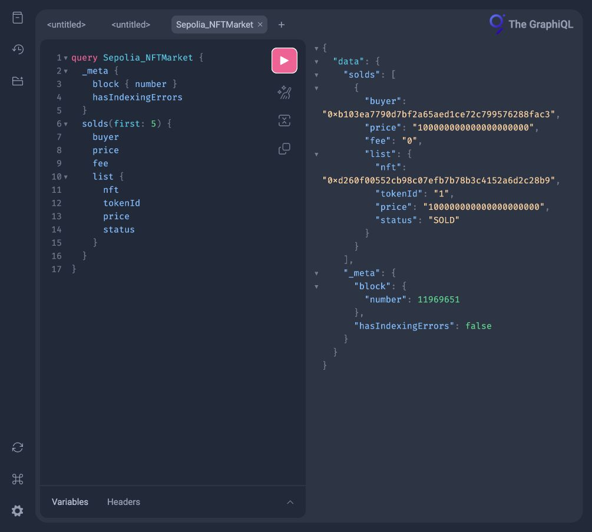

# 31 · 用 The Graph 查 NFTMarket 的上架与成交

这份练习把 [08 的 NFTMarket](../tokenbankv2-08/src/NFTMarket.sol) 的事件变成可以关联查询的数据。当前已完成 **Sepolia 的 8 笔部署和演示交易、三个合约的源码验证、Studio 子图部署与真实查询截图**。查询得到 1 条 `List` 和 1 条 `Sold`，关联与链上回执一致，没有索引错误。代码、公开部署记录、查询响应和截图均保存在本目录，作业提交链接见下文。

题目引用的 [NFTMarket 页面](https://decert.me/quests/abdbc346-8314-4394-8f97-8732780602ed)本次未能读取正文，因此合约行为以仓库 08 的实际实现为准。它的事件叫 `NFTListed`、`NFTSold`；子图里的实体叫 `List`、`Sold`，二者不必同名。

## 一次改价和成交怎样变成查询结果

Alice 先把 1 号 NFT 标价 100 BERC20，又改成 120。Bob 买下后，再按 150 上架。链上市场只保存当前报价；索引需要保留三次上架，不能简单用 `tokenId = 1` 作历史记录 ID。

1. Alice 授权市场并调用 `list`。NFT 仍在她的钱包中，市场发出 `NFTListed`。
2. Graph Node 按区块和日志顺序调用 `handleListed`。每次用“交易哈希 + 日志序号”创建 `List`，另用 `ActiveListing` 保存当前挂单指针。
3. 再次上架时，旧记录标为 `REPLACED`，指针改为新记录。改价不是取消，不填写取消交易哈希。
4. Bob 调用 `buyNFT`，或经支付币的 `transferWithCallback` 购买。市场结算后，代币归卖家，NFT 归买家；任一步失败，挂单、资产和事件一起回滚。
5. `handleSold` 找到当前挂单，核对卖家和价格，创建 `Sold.list` 关联，再把该 `List` 标为 `SOLD` 并删除当前指针。
6. 查询 `solds { list { ... } }` 就能看到成交对应的那次报价；查询 `lists { sales { ... } }` 能反向找到成交。

`LISTED` 只表示最后观测到的是上架事件，不保证此刻仍可购买：卖家可能撤销授权或在市场外转走 NFT。最终能否成交始终由合约判断。

## 与题目参考实体的区别

- `List` 使用 `@entity(immutable: false)`，因为成交发生在后续区块时要更新 `status` 和 `filledTxHash`。不可变实体不能这样更新；`Sold` 保持不可变。
- `Sold.list` 是必填关联。缺失上架或报价不匹配时停止索引，提示检查 ABI、地址和部署区块，不伪造挂单。
- 市场绑定一个 NFT 集合和一种支付币，从 `nft()`、`paymentToken()` 读取；不另加多币种市场。
- 市场没有到期、取消和手续费：`deadline = 0` 表示永不过期，`cancelTxHash = null`，`fee = 0`；未成交时 `filledTxHash = null`。
- `tokenURL` 可空。上架区块的 `tokenURI()` 回滚时保存 `null`；不会下载元数据或图片。同一区块内元数据变化时，读取的是该区块调用可见的状态，不保证是日志发出瞬间的值。
- 当前指针包含市场地址和完整 `uint256 tokenId`，不把 NFT 编号截成 32 位。交易哈希加日志序号也能区分同一交易里的多个事件。

参考：[The Graph 实体与关联](https://thegraph.com/docs/en/subgraphs/developing/creating/ql-schema/)、[子图清单](https://thegraph.com/docs/en/subgraphs/developing/creating/subgraph-manifest/)、[Matchstick 测试](https://thegraph.com/docs/en/subgraphs/tooling/unit-testing-framework/)。

## 先跑不依赖公共网络的验证

需要 Node.js 24、npm、Foundry。保留整个仓库：合约复用 08，OpenZeppelin 和 forge-std 复用 09；不要只复制这个子目录后期待 Foundry 能找到依赖。

从仓库根目录执行：

```bash
cd nft-market-subgraph-31
npm ci
npm run check
npm run test:integration
```

`check` 检查格式、生成 Graph 类型、编译 WASM、严格检查 Node TypeScript、运行配置/映射/合约测试。首次 `graph test` 会下载 Matchstick；平台限制见官方测试文档。`test:integration` 自动选择空闲端口，启动独立 Anvil，部署三个合约，走完改价、普通成交和回调转售，再关闭节点。测试中的 100/120/150 使用代币最小单位，不是 100/120/150 整枚。

Graph 映射使用 AssemblyScript，Node 工具使用 TypeScript，分别由 `graph build` 和 `tsc --noEmit` 检查。Biome 对映射关闭 `useImportType` 和 `noDoubleEquals`：AssemblyScript 不接受 TypeScript 的类型导入语法，字符串内容比较也应使用 `==`/`!=`，不能机械改为引用比较。

阅读顺序：`schema.graphql` → `subgraph.yaml` → `src/mapping.ts` → `tests/market.test.ts`。Node 工具在 `scripts/`，合约部署入口在 `script/Deploy.s.sol`。ABI `abis/NFTMarket.json` 从实际复用合约导出，合约事件变化后必须重新生成：

```bash
forge inspect NFTMarket abi --json > abis/NFTMarket.json
npm run codegen
```

## 手动建立本地链并产生事件

以下都从本项目目录执行，**只用于 Anvil**。先检查端口；如被占用，选择其他端口并同步 Compose 的 RPC 地址，不关闭不明进程。

```bash
lsof -nP -iTCP:18545 -sTCP:LISTEN
anvil --silent --host 127.0.0.1 --port 18545
```

Anvil 留在这个终端运行。在第二个终端进入本项目，设置公开测试地址，先模拟再实际写入本地链：

```bash
export RPC_URL=http://127.0.0.1:18545
export SELLER=0xf39Fd6e51aad88F6F4ce6aB8827279cffFb92266
export BUYER=0x70997970C51812dc3A010C7d01b50e0d17dc79C8
cast chain-id --rpc-url "$RPC_URL"
forge script script/Deploy.s.sol:Deploy --rpc-url "$RPC_URL" --sender "$SELLER"
forge script script/Deploy.s.sol:Deploy --rpc-url "$RPC_URL" --sender "$SELLER" --unlocked --broadcast
```

链 ID 应为 `31337`。脚本依次创建 DemoNFT、BERC20、NFTMarket；支付币全部归部署者。用回执提取地址和市场部署区块，不手填推测值：

```bash
export RECORD=../output-tdd/nft-market-subgraph-31/broadcast/Deploy.s.sol/31337/run-latest.json
export NFT=$(jq -r '.transactions[] | select(.contractName == "DemoNFT") | .contractAddress' "$RECORD")
export PAY_TOKEN=$(jq -r '.transactions[] | select(.contractName == "ERC20WithCallback") | .contractAddress' "$RECORD")
export MARKET=$(jq -r '.transactions[] | select(.contractName == "NFTMarket") | .contractAddress' "$RECORD")
export START_BLOCK=$(cast to-dec "$(jq -r --arg market "$MARKET" '.receipts[] | select((.contractAddress | ascii_downcase) == ($market | ascii_downcase)) | .blockNumber' "$RECORD")")
cast call "$MARKET" 'nft()(address)' --rpc-url "$RPC_URL"
cast call "$MARKET" 'paymentToken()(address)' --rpc-url "$RPC_URL"
```

下面让卖家铸造并上架，买家支付 100 BERC20。`ipfs://example/1.json` 只是演示字符串，没有上传真实元数据；索引验证仅检查链上返回的 URI。

```bash
export PRICE=$(cast to-wei 100 ether)
cast send "$NFT" 'mint(address,uint256,string)' "$SELLER" 1 'ipfs://example/1.json' --from "$SELLER" --unlocked --rpc-url "$RPC_URL"
cast send "$NFT" 'approve(address,uint256)' "$MARKET" 1 --from "$SELLER" --unlocked --rpc-url "$RPC_URL"
cast send "$MARKET" 'list(uint256,uint256)' 1 "$PRICE" --from "$SELLER" --unlocked --rpc-url "$RPC_URL"
cast send "$PAY_TOKEN" 'transfer(address,uint256)' "$BUYER" "$PRICE" --from "$SELLER" --unlocked --rpc-url "$RPC_URL"
cast send "$PAY_TOKEN" 'approve(address,uint256)' "$MARKET" "$PRICE" --from "$BUYER" --unlocked --rpc-url "$RPC_URL"
cast send "$MARKET" 'buyNFT(uint256)' 1 --from "$BUYER" --unlocked --rpc-url "$RPC_URL"
cast call "$NFT" 'ownerOf(uint256)(address)' 1 --rpc-url "$RPC_URL"
cast call "$MARKET" 'listings(uint256)(address,uint256)' 1 --rpc-url "$RPC_URL"
cast call "$PAY_TOKEN" 'balanceOf(address)(uint256)' "$MARKET" --rpc-url "$RPC_URL"
```

预期 NFT 属于买家，挂单返回零地址和 0，市场代币余额为 0。

## 本地 Graph Node 查询

需要可正常运行的 Docker。Compose 使用独立项目、数据卷和端口；数据库仅在容器网络内开放。先确认 `15001`、`18000`、`18020`、`18030` 未占用：

```bash
lsof -nP -iTCP -sTCP:LISTEN | rg ':(15001|18000|18020|18030)\b'
docker compose -p nft-market-subgraph-31 up -d
npm run configure -- local "$MARKET" "$START_BLOCK"
npx graph create nft-market --node http://127.0.0.1:18020
npx graph deploy nft-market subgraph.local.yaml --node http://127.0.0.1:18020 --ipfs http://127.0.0.1:15001 --version-label v0.0.1
```

配置脚本只生成公开地址和区块参数；为防止覆盖已核对的配置，文件已存在时会报错。需要重配时先保留旧文件，再重新生成。`subgraph.yaml` 是零地址模板，只用于代码生成和测试，不能直接当作正式部署配置。

打开 [本地 GraphiQL](http://127.0.0.1:18000/subgraphs/name/nft-market/graphql)，粘贴 [完整查询](queries/market.graphql)。也可以用终端查询真实 Graph Node：

```bash
curl --fail-with-body http://127.0.0.1:18000/subgraphs/name/nft-market \
  -H 'Content-Type: application/json' \
  --data "$(jq -n --rawfile query queries/market.graphql '{query: $query}')"
```

等待 `_meta.block.number` 追上成交区块，确认 `hasIndexingErrors` 为 `false`，并且 `solds[].list.id` 等于对应 `lists[].id`。不要把“GraphQL 返回 HTTP 200”当成索引成功，还要检查响应没有 `errors`。截图应同时显示查询、结果、关联 ID 和所用网络；本地截图不能作为 Sepolia 完成证据。

结束后只关闭本次 Compose 和自己启动的 Anvil。下面命令保留数据卷；如下一次重启的是全新 Anvil，必须用新的 Compose 项目/数据卷重新索引，不能把旧索引连接到一条重置的链。

```bash
docker compose -p nft-market-subgraph-31 down
```

## Sepolia 与正式提交

2026-10-22，使用已授权账户 `0xb103ea7790D7bF2a65AeD1CE72C799576288faC3` 完成部署、铸造 1 号 NFT、NFT 授权、按 100 BERC20 上架、授权恰好 100 BERC20 和自买。8 笔回执的 `status` 均为 `1`；查询时最后一笔已有 15 个确认。实际费用为 **0.000018608277 Sepolia ETH**，低于本次授权上限 0.001 ETH。公开回执摘要见 [deployments/sepolia.json](deployments/sepolia.json)。

这组操作由 `Deploy.runWithDemo()` 完成；原 `run()` 仍然只部署。自买用于产生真实索引事件，不表示独立买家之间的市场交易。Demo NFT 的元数据保存在 `data:` URI 中。成交后已只读核实：NFT 仍归同一账户，挂单已删除，NFT 授权和支付币额度均为零，账户持有全部 BERC20，市场没有扣留支付币。

以下是本次已部署的公开参数，可在本项目目录复制使用：

```bash
export RPC_URL=https://ethereum-sepolia-rpc.publicnode.com
export ACCOUNT=0xb103ea7790D7bF2a65AeD1CE72C799576288faC3
export NFT=0xd260f00552cb98c07efb7b78b3c4152a6d2c28b9
export TOKEN=0xe3b11599cc0354f36b3f337ed8568f4378b1b046
export MARKET=0x020e0284771258816d989a36adfc7abf620865e2
export START_BLOCK=11969545
```

- [NFTMarket 合约](https://sepolia.etherscan.io/address/0x020e0284771258816d989a36adfc7abf620865e2)：部署区块 `11969545`；[部署交易](https://sepolia.etherscan.io/tx/0x889c5f84076d96a9a6159d7198056c709d6a3d9824971b9e1eda777ec7c69c2f)。
- [上架交易](https://sepolia.etherscan.io/tx/0xae4c685bbf26c8d788f1ce5f000c43b976933be1f0f8c311a18dbcb32c3d57c8)：区块 `11969551`、日志序号 `13`，`tokenId = 1`、`price = 100000000000000000000`。
- [成交交易](https://sepolia.etherscan.io/tx/0x741c58c19536030f157d6eea6d2505de4848cea4bc7d6fcc7f01fae46252c628)：区块 `11969555`、日志序号 `87`，买卖双方均为上述账户，价格与上架一致。
- [NFTMarket 的 Sourcify 验证结果](https://sourcify.dev/server/verify-ui/jobs/f8e32654-6fcb-4831-b6f3-b41e8abcc326)：`exact_match`，编译器 `0.8.24+commit.e11b9ed9`、Cancun、优化器 200 次。这是 Sourcify 源码验证，不代表 Etherscan 已同步显示源码。
- [DemoNFT 验证结果](https://sourcify.dev/server/verify-ui/jobs/8a5f4777-080a-40de-b5bb-9d7d8146b620)及 [BERC20 验证结果](https://sourcify.dev/server/verify-ui/jobs/3d2e4232-84a7-4c50-9dab-11178f5ef575)也均为 `exact_match`。

以下命令只读，不会再次广播：

```bash
cast chain-id --rpc-url "$RPC_URL"
cast call "$MARKET" 'listings(uint256)(address,uint256)' 1 --rpc-url "$RPC_URL"
cast call "$NFT" 'ownerOf(uint256)(address)' 1 --rpc-url "$RPC_URL"
cast call "$TOKEN" 'allowance(address,address)(uint256)' "$ACCOUNT" "$MARKET" --rpc-url "$RPC_URL"
```

网络应为 `11155111`；挂单返回零地址和 `0`，NFT 持有人等于 `ACCOUNT`，额度为 `0`。本次广播记录位于 `../output-tdd/nft-market-subgraph-31/broadcast/Deploy.s.sol/11155111/runWithDemo-latest.json`。原 `deploy-authorized.sh` 是固定 nonce 18 的一次性入口，**已经执行，不要重跑**。链上公开数据足够继续索引，无需再次部署。

广播前的 `eth_simulateV1` 连续模拟全部成功。节点部署 gas 约为 Foundry 原估算的 5 倍，因此使用 900% 的 gas multiplier、1,000,000 wei 的 max fee/priority fee 后再次核验；8 笔 gas limit 对应费用上界为 0.000026871327 ETH。该上界与上面的实际费用不同；未来重新部署必须重新核对 RPC、nonce、余额和具体授权，不能照搬旧参数。

本次已在 [Subgraph Studio](https://thegraph.com/studio/subgraph/nft-market-subgraph-31) 部署 `nft-market-subgraph-31` 的 `v0.0.1`，部署 ID 为 `QmPD96PkbBScxKFp9gM3eX6Lzn2htj7n545Hpu87fPeAZ1`。钱包登录和密钥认证由操作者在本机完成，密钥没有写入仓库。

以下为部署过程的复现命令，当前版本已部署，无需再运行。新检出仓库先生成配置，本机已生成 `subgraph.sepolia.yaml` 时跳过第一条，脚本拒绝覆盖已有配置。部署密钥仅在终端提示中输入；更新代码后使用新的版本标签：

```bash
npm run configure -- sepolia "$MARKET" "$START_BLOCK"
npx graph auth
npx graph deploy nft-market-subgraph-31 subgraph.sepolia.yaml --version-label v0.0.1
```

本项目固定的 Graph CLI 0.98.1 不再使用 `--studio` 选项，默认部署到 Studio。本次部署的是 Studio 开发查询版本，没有执行向去中心化网络的 Publish 操作。

## 已验证的查询与截图

打开 [The GraphiQL 查询页面](https://api.studio.thegraph.com/query/1763608/nft-market-subgraph-31/v0.0.1/graphql)，粘贴 [完整双向关联查询](queries/market.graphql) 后点击运行。HTTP 查询端点为：

```text
https://api.studio.thegraph.com/query/1763608/nft-market-subgraph-31/v0.0.1
```

也可直接执行下面的只读查询，无需钱包签名或部署密钥：

```bash
curl --fail-with-body --silent --show-error \
  https://api.studio.thegraph.com/query/1763608/nft-market-subgraph-31/v0.0.1 \
  -H 'Content-Type: application/json' \
  --data '{"query":"{ _meta { block { number } hasIndexingErrors } solds { buyer price fee list { tokenId price status } } }"}'
```

本次 [完整响应快照](queries/sepolia-response.json) 的索引区块为 `11969643`，已经超过成交区块 `11969555`。实际返回 1 条上架和 1 条成交；核对了 `Sold.list.id == List.id`、`List.sales[0].id == Sold.id`、交易哈希、日志序号、买卖账户、价格、NFT 地址和元数据，均与链上记录一致。上架状态为 `SOLD`，成交价格为 100 BERC20，手续费为零，`hasIndexingErrors` 为 `false`。

下面截图来自上述真实端点的 GraphiQL 页面，使用 [精简截图查询](queries/sepolia-proof.graphql)，截图时索引到区块 `11969651`。`solds.list` 展示成交关联的上架记录；截图未修改查询结果，也不包含部署密钥。



作业提交资料：

- [GitHub 项目源码](https://github.com/woyaofei303/block-chain-list/tree/main/nft-market-subgraph-31)。复现时克隆整个仓库，以保留 08 的合约和 09 的依赖。
- [真实查询截图](screenshots/sepolia-list-sold.jpg)，对应 [可复制查询](queries/sepolia-proof.graphql)。

## 本次验证与限制（2026-10-22）

- Matchstick 映射测试 7 项通过；配置校验 2 项通过；Forge 合约测试 5 项通过（含本次新增的自买、余额保持和授权耗尽验证）。
- Graph 类型生成和 WASM 构建通过；Node TypeScript strict 检查通过。
- 共享 pre-commit 在临时 Git index 和正常本地提交中均已执行通过，覆盖新项目检查。目录索引、文档链接、ABI 与合约一致性检查通过。
- 部署脚本本地模拟通过；独立 Anvil 实际部署、改价、普通成交和回调转售通过，结束已关闭测试节点。
- Sepolia 的 8 笔广播交易已从 RPC 独立查询回执并确认成功；费用、事件主题、tokenId、价格、买卖账户、挂单清除、授权归零及合约绑定地址检查通过。
- 使用真实地址和起始区块的 `subgraph.sepolia.yaml` 构建通过；三个合约的 Sourcify 源码验证均为 `exact_match`。
- Studio `v0.0.1` 部署成功；真实 Sepolia 索引、HTTP GraphQL 查询、双向关联及截图均已验证。
- Docker Compose 配置校验通过，但本机 Docker 镜像存储返回 `input/output error`，本地 Graph Node 仍未启动；上述端到端验证使用 Studio，不依赖本机 Docker。
- Foundry 模拟/集成日志有 trace 源码解析及未配置 Etherscan 的告警；实际源码验证另用 Sourcify 完成，未验证 Etherscan 同步状态。
- `npm audit` 报告 Graph CLI 工具依赖中的 21 项漏洞（5 moderate、15 high、1 critical）；兼容范围内的 `npm audit fix` 未消除，未强制降级工具或引入未经验证的替换。不要用这套 CLI 解包不可信工程；上线前需复核上游修复。
- 原始日志位于仓库 `output-tdd/nft-market-subgraph-31/`，不随源码提交。没有把本地事件、模板地址或预期结果当作 Sepolia 证据。
